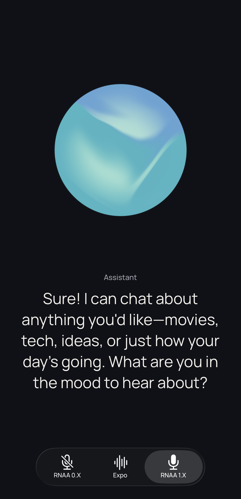

# AEC Workshop

A React Native / Expo voice-agent comparison with two presentations: a developer workshop and a minimal, three-tab promo app. Both use real microphone input, assistant audio, and transcripts—not prerecorded conversations.

Built with Expo SDK 57, React Native 0.86, stock Expo Audio, and an official React Native Audio API (RNAA) nightly. No custom native patches or local library checkout is required. **Expo Go is not supported.**

## Comparisons

| Workshop tab | Audio path |
| --- | --- |
| Voice | RNAA communication capture and voice output; platform voice processing where available |
| Defaults | RNAA without voice processing, with media output |
| Media | RNAA communication capture with media output; Android only |
| Expo | Stock Expo Audio half duplex; pauses the microphone during replies |
| Duplex | Stock Expo Audio simultaneous capture and progressive AAC playback |

Android's Expo tab also includes a six-capture `mic` versus `voice_communication` recorder diagnostic. iOS hides Media and this Android-only diagnostic.

Promo mode shows **RNAA 0.X → Expo → RNAA 1.X**, with a tappable animated orb and live captions. These are comparison labels: both RNAA tabs use the **same installed package**, with different processing options. Expo uses full duplex, not half duplex. Voice / RNAA 1.X remains the home screen.

AEC means acoustic echo cancellation. Results depend on the device, route, volume, and room; this showcase does not establish production readiness or universal Expo limitations. iPhone Expo full duplex remains an acoustic experiment, not a device-verified guarantee.

## Requirements

- macOS or Linux, Git, [Bun](https://bun.sh/), and Node.js 24.3+.
- [ffmpeg](https://ffmpeg.org/) available on `PATH` for Expo playback and diagnostics.
- Android Studio / Android SDK for Android; macOS, Xcode, and a development signing team for iOS.
- A physical phone on the same LAN as the development computer. RNAA's Android communication comparisons require Android 12 / API 31+; the app minimum is API 26.

## Install and configure

```bash
git clone https://github.com/maciejkucmierz-swm/aec-workshop.git
cd aec-workshop
bun install --frozen-lockfile
cp .env.example .env.local
```

Set `OPENAI_API_KEY` in `.env.local` to your OpenAI API key. It is read only by the local server. **Never name it `EXPO_PUBLIC_OPENAI_API_KEY`, commit it, or include local environment files or development logs in shared artifacts.** An existing shell `OPENAI_API_KEY` takes precedence over `.env.local`; unset it if the server uses an old key.

The model, voice, and VAD (voice activity detection) settings live in [shared/realtime-config.json](shared/realtime-config.json). Your API account must have access to the configured models. The relay is a trusted-LAN demo server, not an authenticated public service.

## Run in three terminals

Run each command from the repository root.

**1. Local voice relay**

```bash
bun run token-server
```

It listens on port 8787. Check `http://localhost:8787/health`; `ffmpegAvailable` should be `true`. Restart this process after server changes.

**2. Metro — choose a presentation**

```bash
# Minimal promo app:
EXPO_PUBLIC_APP_MODE=promo bun run start -- --dev-client --lan --port 8081

# Or the full workshop, instead of the command above:
EXPO_PUBLIC_APP_MODE=workshop bun run start -- --dev-client --lan --port 8081
```

You can also set `EXPO_PUBLIC_APP_MODE=promo` in `.env.local`. Unset it for the workshop; any value other than `promo` selects the workshop. Changing modes requires a Metro restart, **not** a native rebuild.

**3. Build, install, and open on a phone**

```bash
# iPhone (macOS only):
bun run ios -- --device --port 8081

# Or Android:
bun run android -- --device --port 8081
```

Select your connected device when prompted. On iPhone, keep it unlocked, enable Developer Mode, choose your own signing team if requested, and trust the developer profile in Settings when required. Allow microphone and local-network access. If signing fails, open `ios/aecworkshop.xcworkspace` in Xcode and configure Signing & Capabilities for your team.

After the first build, open the installed development client and select Metro / scan its QR code. JavaScript-only changes do not need another native build. Dependency or native configuration changes do: run `bun install --frozen-lockfile`, `bunx expo prebuild --platform ios` (or `android`), then the build command above.

If 8081 is occupied, replace it in **both** Metro and build commands with a free port, such as 8084. Do not combine Expo's `--port` and `--no-bundler` options. Stop relay and Metro with Ctrl+C.

### LAN troubleshooting

Metro normally supplies the computer's LAN host. If the relay is unreachable, set `EXPO_PUBLIC_TOKEN_URL=http://YOUR_COMPUTER_LAN_IP:8787` in `.env.local` and restart Metro. Do not use `localhost` for a physical phone. If changing `TOKEN_SERVER_PORT`, update this URL too. Allow the ports through your firewall and avoid guest Wi-Fi client isolation.

## Using promo mode



Tap the orb to start, tap again to end, or tap while connecting to cancel. Only the visible tab prepares a connection; microphone capture starts after your tap. Changing tabs or backgrounding ends the call. Preparation can affect other apps' audio.

The shared TypeGPU orb follows connection, speech-detection, and playback state; it is decorative, not an audio waveform. Captions reveal at an approximate speech pace, not word-level alignment. Light/dark appearance and Reduce Motion are supported. Web has a simple fallback control; physical Android/iPhone are the comparison targets.

## Upstream RNAA, without patches

The lockfile pins `react-native-audio-api@1.0.0-nightly-331cd7c-20261023`, containing [#1323](https://github.com/software-mansion/react-native-audio-api/pull/1323), [#1324](https://github.com/software-mansion/react-native-audio-api/pull/1324), and [#1317](https://github.com/software-mansion/react-native-audio-api/pull/1317). This is an official **nightly**, not a stable 1.0 release.

- Voice / RNAA 1.X: `androidInputPreset: "voiceCommunication"`, `iosVoiceProcessing: true`, Android output `voiceCommunication`.
- Defaults / RNAA 0.X: `androidInputPreset: "voiceRecognition"`, `iosVoiceProcessing: false`, Android output `media`.
- Media: Voice capture options with Android output `media`.

All RNAA profiles use public session APIs. Android uses `inCommunication`; iOS uses `playAndRecord` / `voiceChat`, with `defaultToSpeaker` selected for the speaker preference. iOS routing is a preference, not a forced override. Context/recorder ownership and teardown are shared and serialized. Expo remains stock. Upstream documents an iOS Siri / Bluetooth-HFP interruption-recovery limitation; background and headset behavior are not acceptance targets.

## Checks and manual comparison

```bash
bun run check
bunx expo config --type public
git diff --check
```

`check` runs TypeScript, Expo lint, and server syntax validation. Build success does not establish acoustic quality. On each physical device, keep position, loudspeaker volume, network, and prompt fixed:

1. Ask for a long reply and stay silent; note self-transcription or false interruptions.
2. Interrupt during speech and late buffered playback; check for prompt cancellation and stale replay.
3. Confirm Duplex's microphone/relay buffer counts increase during audible assistant playback. Half duplex should pause capture for every reply and resume afterward.
4. Disconnect/reconnect and change tabs during playback; check that the old call stops. Verify RNAA Phone/Speaker routes by listening.
5. On Android, run the recorder diagnostic in a quiet room. Treat its results as device-specific evidence, not proof that AEC is enabled.

## Project layout and credits

`src/app` contains routes, `src/components` shared presentation and Expo experiments, `src/lib` RNAA sessions and shared utilities, and `server` the token/voice relay. Generated `ios/`, `android/`, `node_modules/`, and `.expo/` are ignored.

The project retains the [MIT license](LICENSE). Manrope is supplied by `@expo-google-fonts/manrope` under the bundled SIL Open Font License. The orb flow is adapted from `claude-app-clone-main` with permission.
